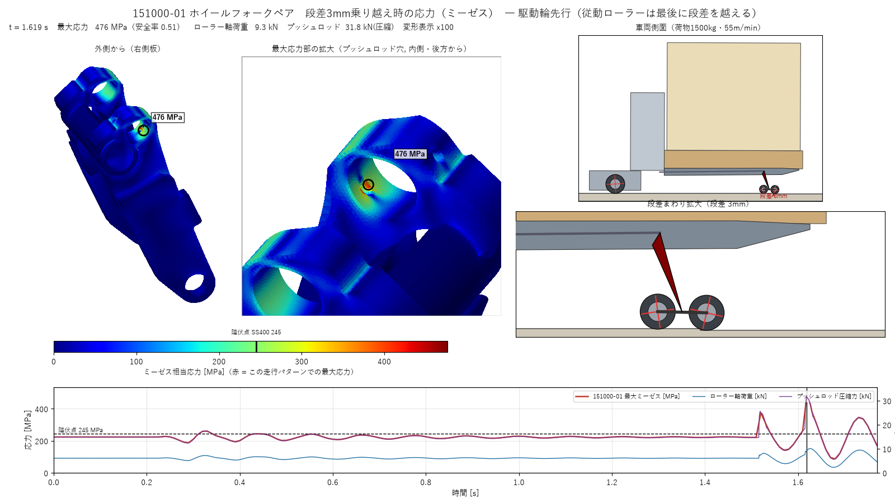
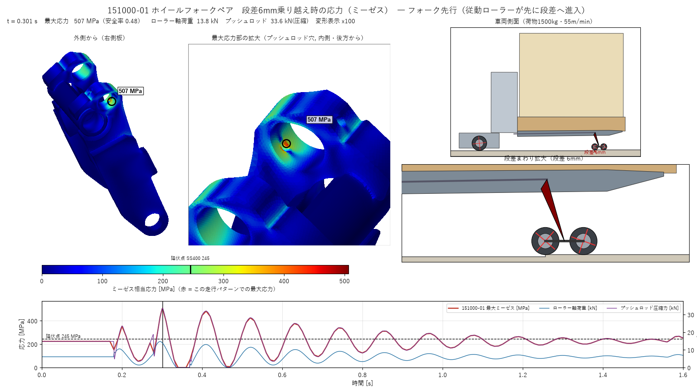
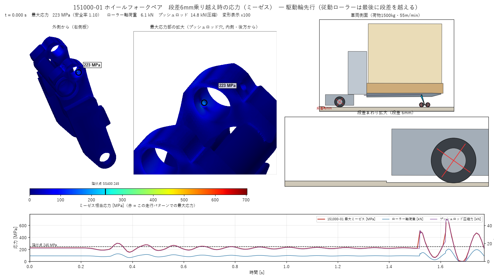

# 151000-01 段差乗り越え強度検証

ABM15M ／ 図番 151000-01 ホイールフォークペア ／ 動的段差乗り越え解析 ＋ 3D FEM

荷物 1500 kg（パレット1100 中央）・走行 55 m/min・段差 6 mm（直角）・側板 SS400 / パイプ STKM13A

> [!CAUTION]
> **判定：NG**
>
> 最大応力はプッシュロッド穴（φ20.1）の縁、外側の肉が薄い部分（肉厚 約6〜8 mm）で発生します。
> ミーゼス応力は **静的（平地走行）でも 224 MPa**（降伏点245 MPaに対して安全率1.10）です。段差乗り越え時は
> **フォーク先行で 507 MPa、駆動輪先行で 703 MPa** となり、降伏点を大きく超えます。主応力は引張（σ1 = 674 MPa）なので、
> 局所降伏と、繰り返し段差を越えることによる疲労き裂の起点になる可能性が高い箇所です。

## 1. 応力アニメーション

### 駆動輪先行（最悪）

▶ [動画を見る（YouTube）](https://youtu.be/fTamhkVOVek)

駆動輪が先に段差を越え、約1.3秒後に従動ローラーが後ろから段差に乗り上げます。ローラーが段差の角に当たった直後（t = 1.62 s）がピークです。色は 0〜703 MPa（赤が最大）、変形は100倍表示、再生は実時間の約1/6です。

### フォーク先行

▶ [動画を見る（YouTube）](https://youtu.be/EQTZnDR1nYM)

従動ローラーが先に段差の角に当たり（t = 0.18 s）、車体の上下振動でピーク（t = 0.30 s）になります。色は 0〜507 MPa（赤が最大）です。

## 2. 結果一覧

| 状態 | ローラー軸荷重 kN | プッシュロッド圧縮 kN | パイプ反力 kN | 最大ミーゼス MPa | 最大主応力 σ1 MPa | 降伏安全率 |
|:--|--:|--:|--:|--:|--:|--:|
| 静的（平地・荷物積載） | 6.1 | 14.8 | 16.1 | 224 | 214 | ⚠️ 1.10 |
| フォーク先行 ピーク | 13.8 | 33.6 | 36.4 | 507 | 485 | ❌ 0.48 |
| 駆動輪先行 ピーク | 11.8 | 47.0 | 51.9 | 703 | 674 | ❌ 0.35 |

荷重は片側1組（151000-01 1個）あたりです。駆動輪先行では、段差の角からローラーに後ろ向きの力が入ります。この力がパイプまわりのモーメントを増やすため、ローラー軸荷重は小さくてもプッシュロッド力が最大になります。

### 部位別の最大応力（駆動輪先行ピーク）

| 部位 | 静的 MPa | ピーク MPa | 材料 降伏点 MPa | 判定 |
|:--|--:|--:|--:|:-:|
| プッシュロッド穴 内面（ミーゼス最大点） | 224 | 703 | 245 | ❌ NG |
| プッシュロッド穴 外側の縁（自由縁, σ1） | 118 | 374 | 245 | ❌ NG |
| パイプ（STKM13A, 端部） | 90 | 265 | 215 | ❌ NG |
| パイプ-側板 溶接部（側板側） | 49 | 138 | 245 | ✅ OK |
| ローラー軸穴まわり | 36 | 99 | 245 | ✅ OK |

パイプ端の値は、溶接で一体化したパイプと側板の境界の角で出ています。メッシュに依存しやすい箇所なので参考値です。

| 静的状態（t = 0） | 駆動輪先行のピーク時（t = 1.62 s） |
|:-:|:-:|
|  |  |

## 3. フォーク剛性に対する感度

段差衝撃の大きさは、フォーク先端の上下剛性（フォークのたわみやすさ）で大きく変わります。基準は 2000 N/mm（静的たわみ 約3 mm）としました。最大応力はプッシュロッド力にほぼ比例する（15.1 MPa/kN）ため、他の剛性のケースは比例換算で示します。

| フォーク先端剛性（片側） | フォーク先行 ロッド kN | 最大ミーゼス MPa | 駆動輪先行 ロッド kN | 最大ミーゼス MPa |
|:--|--:|--:|--:|--:|
| 1000 N/mm（柔らかめ） | 20.4 | 307 | 33.4 | 503 |
| **2000 N/mm（基準, FEM直接計算）** | **33.6** | **507** | **47.0** | **703** |
| 5000 N/mm（硬め） | 50.6 | 763 | 44.2 | 667 |
| 剛体（上限） | 116.1 | 1751 | 104.9 | 1581 |

最も柔らかい想定でも、ピークは降伏点の2倍を超えます。静的でも安全率は1.10しかないため、この剛性の不確かさで判定は変わりません。

## 4. 解析モデル

### 動力学（側面2D、左右対称）

- 車体（フレーム・フォーク・駆動ユニット・荷物）を1つの剛体として扱います。油圧はロックし、ベルクランクとプッシュロッドは固定です。
- フォーク先端（151000-01・タンデムローラー）は、ばね（2000 N/mm）で上下に支えます。減衰比は5%です。
- タンデムローラー（R32.5、ピッチ90）はローラー軸穴まわりに揺動できます。駆動輪はR75です。
- ウレタン車輪の接触は F = Kδ1.5(1+αδ̇) で表します（ローラーは3 kNで0.5 mm、駆動輪は6 kNで1 mm沈む設定、α = 1.3 s/m）。
- 駆動輪は55 m/minを保つように牽引します（μ = 0.6 で頭打ち）。段差は高さ6 mmの直角段差です。

### FEM（151000-01単体）

- STEP の「151000-01ビードあり」を使用しました。2次四面体 約33万要素（156万自由度）、穴まわりは1 mmメッシュです。
- パイプと側板のすき間（約1.1 mm、開先溶接部）は溶接金属で埋まっているとみなし、一体化しました。
- パイプ内面（フレームへの揺動ピン）は固定、ローラー軸穴とプッシュロッド穴にはピン荷重（cos分布）を左右の側板へ1/2ずつかけました。
- プッシュロッド力は、151000-01単体のパイプ中心まわりのモーメント釣り合いから求めました（静的でローラー軸荷重の2.45倍）。
- メッシュ収束：全体3 mmでは224 MPa、局所1 mmでは224 MPa（差は1%未満）です。

## 5. 前提と仮定

| 項目 | 内容 |
|:--|:--|
| 荷物 | 1500 kg。重心はバックレストから550 mm、フォーク上面から500 mm（荷姿の高さ1000を仮定） |
| 車両自重 | 300 kg（STEPの体積から推定）、重心 Y −950 / Z 400 |
| リフト状態 | STEPの状態（フォーク上面 Z 201） |
| フォーク剛性 | 2000 N/mm（C形鋼 約150×45 t4。片持ち梁と、パレットに支えられる状態の中間を想定） |
| 材料 | E = 206 GPa、ν = 0.3。SS400 σy 245、STKM13A σy 215 MPa |
| 無視したもの | スタビライザキャスタ、151000-01の自重・慣性、ピン穴のすき間、溶接の残留応力 |

## 6. 対策案

1. **プッシュロッド穴まわりの肉を増やします。** 穴の外側の縁までの距離（現状 約6〜8 mm）を広げるか、ボス外形を大きくします。静的でも安全率は1.1しかないため、最優先です。
2. **レバー比を見直します。** プッシュロッド穴をパイプ中心からさらに離すと（現状のモーメントアームは22.7 mm）、ロッド力と穴縁の応力が比例して下がります。
3. **材料を高強度にします。** SS400から高張力鋼などに変えます。ただし疲労の観点では形状の改善を優先します。
4. **現物で確認します。** 実機で穴縁にひずみゲージを貼り、段差を越えるときの応力を測ると、フォーク剛性と減衰の仮定を検証できます。

## 7. ファイル

`01_sim/151000/`

| ファイル | 内容 |
|:--|:--|
| [mesh_part.py](mesh_part.py) | STEPから151000-01を抽出して溶接部を一体化し、メッシュを作成 |
| [sim2d.py](sim2d.py) | 段差乗り越えの動力学（`--sens`でフォーク剛性の感度） |
| [fem.py](fem.py) | tet10の線形FEM（全フレームを一括で解く） |
| [principal.py](principal.py) | 主応力の確認 |
| [animate.py](animate.py) | 応力アニメーション（MP4・PNG） |

`fem_drive_first.npz` / `fem_fork_first.npz`（FEM結果、各80MB前後）は容量が大きいためリポジトリに含めていません。`fem.py` を実行すると再生成できます。
